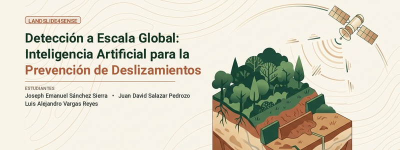

<!-- Espacio para el banner -->

## Autores

- Joseph Emanuel Sánchez Sierra
- Juan David Salazar Pedrozo
- Luis Alejandro Vargas Reyes

## Objetivo

Detectar deslizamientos de tierra a partir de imágenes satelitales multiespectrales y topográficas, mediante modelos de inteligencia artificial, para apoyar la alerta temprana y la gestión de desastres.

## Dataset

- Obtenido en:[ https://www.kaggle.com/datasets/tekbahadurkshetri/landslide4sense ]

## Modelos

- Decision Tree (Árbol de decisión) from scikit-learn
- Deep Neural Network (Red neuronal profunda) built with TensorFlow/Keras
- K-Means (Agrupamiento) from scikit-learn
- Dimensionality Reduction (Reducción de dimensionalidad) from scikit-learn

## Enlaces

- Código: [ https://colab.research.google.com/drive/1IBbMhE-PhhDseHRMWqaAX9eBTGdYQWJV ]
